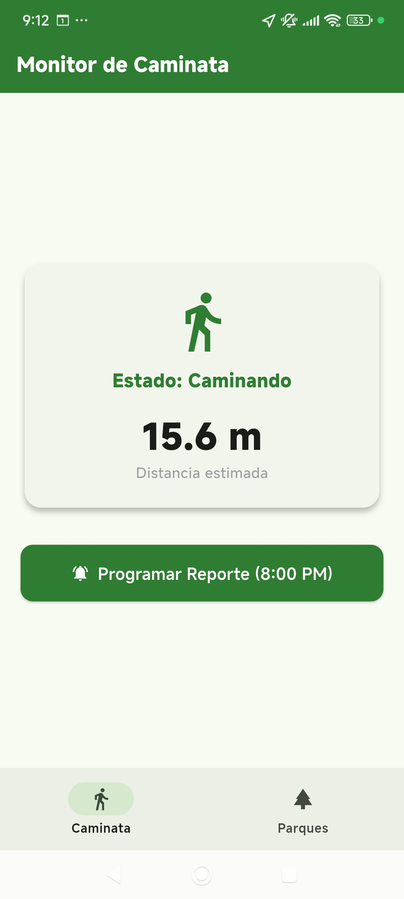
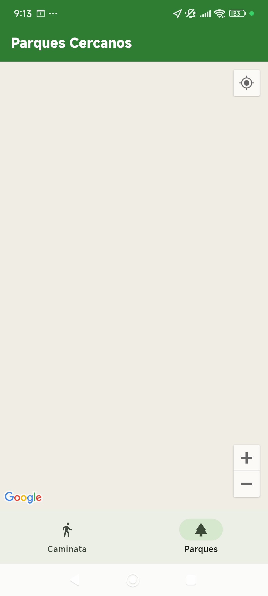

# Taller de Movilidad y Sensores — Flutter

Aplicación móvil desarrollada en **Flutter** para el monitoreo de actividad física (caminata mediante sensores del dispositivo), notificaciones locales, retroalimentación háptica (vibración) y búsqueda de parques cercanos en mapa.

## Funcionalidades principales

- **Detección de caminata con sensores:** Lectura de sensores en tiempo real para identificar movimiento y distinguir entre estado detenido y caminando.
- **Retroalimentación háptica y notificaciones:** Alertas visuales y vibración al detectar actividad.
- **Mapa de parques cercanos:** Vista de ubicación y búsqueda de parques cercanos mediante servicios de geolocalización y mapas.
- **Estructura modular:** Organización en pantallas (`screens`), servicios (`services`), componentes (`widgets`) y tema (`theme`).

## Capturas de pantalla

| Monitoreo de Caminata | Vista del Mapa |
| :---: | :---: |
|  |  |
| *Sensor y estado de caminata* | *Observación: la vista del mapa se muestra en blanco actualmente* |

## Estado actual y observaciones

- **Funcionando:** Detección de movimiento/caminata con sensores, vibración en el dispositivo y navegación entre pantallas.
- **Observación conocida:** La vista del mapa actualmente se renderiza en blanco (pendiente de configurar o validar la carga del mapa/clave).

## Estructura del proyecto
lib/
├── main.dart                         # Punto de entrada y navegación principal
├── screens/
│   ├── tracker_screen.dart           # Pantalla principal de seguimiento
│   └── map_screen.dart               # Vista del mapa y parques cercanos
├── services/
│   ├── notification_service.dart     # Gestión de notificaciones locales
│   └── park_service.dart             # Consulta de parques cercanos
├── theme/
│   └── app_theme.dart                # Paleta de colores y estilos
└── widgets/
└── step_counter_widget.dart      # Widget del sensor y estado de caminata

## Ejecución del proyecto

1. Tener instalado **Flutter SDK** y un dispositivo o entorno compatible.
2. Instalar dependencias:
